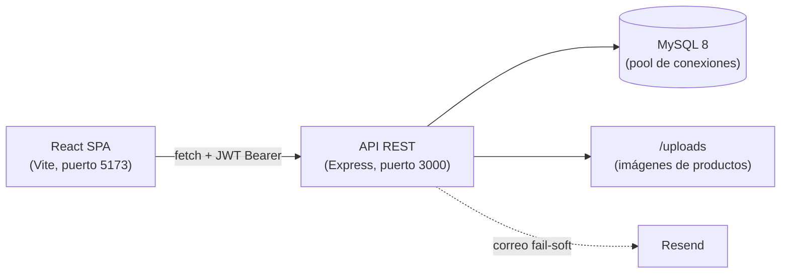

# CommerCity

**Estado:** Proyecto académico en etapa productiva | Backend: 413/413 pruebas OK (25 archivos, última corrida completa 2026-10-08) | Frontend: 25/25 pruebas OK (7 archivos) | Móvil (Capacitor) y Escritorio (Electron): cableados a la API y verificados (capa de red 102/102, RF4 12/12) | Cobertura backend: 95.37% líneas

CommerCity es una plataforma de comercio electrónico para mercados locales con roles de comprador, vendedor y administrador. Incluye catálogo de productos con imágenes, carrito de compras, pedidos, pasarela de pago simulada, tiendas de vendedores, chat, notificaciones, seguidores, calificaciones, reportes de contenido y panel de administración.

## Contexto académico

Proyecto productivo desarrollado en el marco del **SENA**, programa **Tecnólogo en Análisis y Desarrollo de Software (ADSO)**, como alternativa de **Proyecto Productivo** dentro de la **Formación Profesional Integral (FPI)** y la **etapa productiva**. La fuente única de requerimientos es el documento oficial vigente (versión final del 2026-08-20), conservado por el equipo fuera del control de versiones; el mapeo RF/RNF aplicado al código está en `docs/bd/modelo-datos.md` y `docs/api/inventario-endpoints.md`.

## Características principales

- **Tres roles** con permisos diferenciados: comprador, vendedor y administrador (RBAC con JWT).
- **Catálogo y búsqueda:** productos con imágenes, categorías, etiquetas, filtros y búsqueda global.
- **Carrito y pedidos:** carrito persistente por usuario, creación de pedidos y pasarela de pago simulada; cancelación por línea con reembolso proporcional (el importe de cada línea cancelada se acumula en `pagos_simulados.monto_reembolsado` y el pago pasa a `Reembolsado` solo cuando se cubre el monto total, RF135/RF35).
- **Tienda del vendedor:** publicación y gestión de productos, estadísticas de ventas, cuenta bancaria cifrada.
- **Interacción social:** chat comprador-vendedor, seguidores, calificaciones de productos y vendedores, reportes de contenido.
- **Notificaciones** internas y **correo transaccional** (Resend, con modo simulación si no hay API key).
- **Panel de administración:** gestión de usuarios, productos, pedidos, reportes, estadísticas y búsqueda global.
- **Seguridad:** contraseñas con bcrypt, JWT con lista negra de tokens, validación de entrada con Zod, helmet, CORS con allow-list y rate limiting en login/recuperación.
- **Multicanal:** SPA web (React), app móvil (Capacitor) y app de escritorio (Electron) contra la misma API REST.
- **IVA y comisiones:** el precio publicado ya incluye el IVA del 19%; el desglose (subtotal = precio / 1.19, IVA = subtotal × 0.19) se calcula en la pasarela y la comisión se reparte 90/10 sobre el subtotal (RF48, RF121, RF140).

## Arquitectura

Arquitectura cliente-servidor: una SPA de React consume una API REST de Express, que persiste en MySQL y sirve las imágenes subidas como archivos estáticos.



Pipeline de middlewares y flujo de una petición autenticada:

```text
Petición entrante
  -> helmet, CORS (allow-list CORS_ALLOWLIST: FRONTEND_URL + orígenes de Capacitor; null/file:// solo con ALLOW_DESKTOP_ORIGINS), express.json
  -> rate limit: base 200/15 min en /api + 10 peticiones/min en /api/usuarios/login y /api/usuarios/recover (el lote de auditoría agrega límites específicos)
  -> auth.middleware: JWT Bearer + lista negra en BD (tokens_invalidados, hash SHA-256)
     + verificación de usuarios.activo (fail-closed)
  -> role.middleware: control de acceso RBAC por roles
  -> validate.middleware: validación de entrada con esquemas Zod
  -> controller: lógica de negocio + autorización por ownership
  -> respuesta uniforme { success, data } o errorHandler centralizado
```

## Stack tecnológico

### Backend (`backend/package.json`)

| Tecnología                               | Uso                                  | Versión          |
| ---------------------------------------- | ------------------------------------ | ---------------- |
| Node.js                                  | Runtime                              | 22+              |
| Express                                  | Framework web                        | ^5.2.1           |
| MySQL2                                   | Driver de MySQL (pool de conexiones) | ^3.24.5          |
| jsonwebtoken                             | Autenticación JWT                    | ^9.0.3           |
| Zod                                      | Validación de entrada                | ^4.6.5           |
| Multer                                   | Carga de archivos                    | ^2.4.0           |
| helmet                                   | Cabeceras de seguridad               | ^8.3.0           |
| express-rate-limit                       | Limitación de peticiones             | ^8.7.0           |
| Resend                                   | Correo transaccional                 | ^6.32.0          |
| bcrypt                                   | Hash de contraseñas                  | ^6.0.0           |
| cors / dotenv                            | CORS y variables de entorno          | ^2.8.6 / ^17.4.2 |
| Vitest + supertest + @vitest/coverage-v8 | Pruebas y cobertura                  | ^4.1.11 / ^7.3.1 / ^4.1.11 |

### Frontend (`frontend/package.json`)

| Tecnología                             | Uso                              | Versión                 |
| -------------------------------------- | -------------------------------- | ----------------------- |
| React + React DOM                      | Biblioteca de UI                 | ^19.2.4                 |
| React Router DOM                       | Enrutado SPA                     | ^7.14.2                 |
| Vite                                   | Bundler y servidor de desarrollo | ^8.0.1                  |
| Tailwind CSS (vía @tailwindcss/vite)   | Estilos                          | ^4.2.2                  |
| framer-motion                          | Animaciones                      | ^12.38.0                |
| lucide-react                           | Iconos                           | ^1.8.0                  |
| swiper                                 | Carruseles                       | ^12.1.3                 |
| Vitest + jsdom + React Testing Library | Pruebas                          | 5.0.1 / 30.1.1 / 16.3.3 |

## Estructura del repositorio

```text
COMMER CITY/
├── backend/
│   └── src/server/
│       ├── __tests__/      # 25 archivos de pruebas (Vitest + supertest)
│       ├── config/         # db.js, multer.js
│       ├── controllers/    # Controladores por módulo (incluye subcarpeta admin/)
│       ├── db/             # Migraciones SQL incrementales (000 y 008-018, idempotentes, con rollback en comentarios)
│       ├── middleware/     # auth, error, role, validate
│       ├── routes/         # 12 archivos de rutas por módulo
│       ├── schemas/        # Esquemas Zod de autenticación
│       ├── utils/          # config, crypto, finanzas, mailer, response, reembolsos
│       ├── app.js          # Middlewares globales y montaje de routers
│       └── server.js       # Arranque del servidor (puerto 3000)
├── frontend/
│   ├── src/
│   │   ├── api/            # client.js: cliente HTTP con JWT Bearer
│   │   ├── components/     # Carrito, admin, globales, inicio, perfil, tienda
│   │   ├── constants/      # config.js (API_BASE_URL) y tokens de diseño CSS
│   │   ├── data/
│   │   ├── pages/          # Administrador, Carrito, IniciarSesion, Inicio, Perfil, Tienda
│   │   ├── services/       # Servicios por módulo contra la API
│   │   ├── test/           # setup.js (jsdom)
│   │   └── utils/
│   ├── public/
│   ├── .nvmrc              # Node 22.23.2
│   └── package.json
├── apps/
│   ├── movil/              # Snapshot versionado de la app Capacitor (www/ con api.js de los 72 endpoints)
│   ├── escritorio/         # Snapshot versionado de la app Electron (src/ con api.js)
│   └── README.md           # Builds (APK/EXE), exclusiones y notas de firma (keystore)
├── docs/                   # Requerimientos, entregas, informes y evidencias
│   ├── informes/           # Versionada por excepción (ver .gitignore): INFORME_AUDITORIA_PREVIEW_*.md
│   │   └── INFORME_AUDITORIA_PREVIEW_2026-10-05.md
│   ├── DRIVE/              # Documentación del equipo (315 archivos, ~31 MB: Documentación, Guía de Diseño, Iconos, Imágenes). Rutas de hasta 179 caracteres: en Windows usa `git config --global core.longpaths true` (ver docs/guias/ramas-obsoletas.md)
│   ├── CHANGELOG.md        # Bitácora de cambios (fecha real, evidencia y estado)
│   └── AVANCES/            # Fuentes locales de las apps + PRUEBAS (gitignorado)
├── schema_commercity.sql   # Esquema oficial (crea la BD local commercity_dev; guarda A-6 contra las bases compartidas)
├── seed_commercity.sql     # Datos de prueba (usuarios con hashes bcrypt, productos, pedidos)
├── VERSION                 # Versión SemVer del proyecto
└── .gitignore
```

## Rama PREVIEW del repo oficial (pruebas del equipo)

El código para que todo el equipo pruebe el proyecto se publica en la rama **`PREVIEW`** del repositorio oficial: `https://github.com/diegoSerna17/Commercity`.

**Descargar PREVIEW (clon nuevo):**

```bash
git clone -b PREVIEW https://github.com/diegoSerna17/Commercity.git
cd Commercity
```

**Actualizar PREVIEW (clon existente):**

```bash
git checkout PREVIEW
git pull origin PREVIEW
```

> \[!NOTE]
> Si en lugar de clonar el repo oficial añadiste ese remoto manualmente a un clon de ECOMMERCE, el nombre del remoto es el que le hayas puesto (en este proyecto, `commercycity`): usa `git fetch commercycity` y `git pull commercycity PREVIEW`.

Notas:

- `PREVIEW` contiene el código consolidado (backend, frontend, apps, esquema y seed SQL, README) **más** la documentación del equipo trackeada en git: `docs/DRIVE/` (315 archivos: Documentación, Guía de Diseño, Iconos, Imágenes de Categorías), `docs/informes/` y `docs/CHANGELOG.md`.
- `docs/DRIVE` pesa ~31 MB y tiene rutas de hasta 179 caracteres: en Windows activa `git config --global core.longpaths true` o usa un checkout disperso que lo excluya (detalle en `docs/guias/ramas-obsoletas.md`).
- NO se versionan en PREVIEW los dumps de base de datos (carpeta `docs/DRIVE/Base de Datos - Commercity 2.0/`, con hashes bcrypt y datos personales) por ser un repositorio público, ni `graphify-out/`, `Scripts.txt` ni el resto de carpetas de `docs/` (LAST VERSION, metodologia, etc.), que viven solo en el repositorio ECOMMERCE.
- `PREVIEW` se actualiza con merge desde `main` (del repositorio ECOMMERCE); en esos merges el `docs/CHANGELOG.md` de PREVIEW **no se modifica** — la bitácora oficial del proyecto se lleva en ECOMMERCE.
- Las ramas `main` y `master` del repositorio oficial **no se tocan**: las organizan los líderes al finalizar el proyecto.
- La rama no incluye secretos: solo va `backend/.env.example`; cada quien crea su propio `.env`.

## Instalación y ejecución

**Requisitos:** Node.js 22+ (el frontend exige `>=22.22.2`), npm y acceso a una base de datos MySQL 8 (el servidor compartido del equipo o una local).

Los pasos 4 y 5 son opcionales: solo se necesitan si vas a probar la app móvil o la de escritorio.

```bash
# 1. Clonar el repositorio oficial en la rama PREVIEW
git clone -b PREVIEW https://github.com/diegoSerna17/Commercity.git
cd Commercity

# 2. Backend
cd backend
npm ci                        # instala segun package-lock.json (o npm install)
Copy-Item .env.example .env   # completa los valores (ver Configuracion)

# 3. Frontend
cd ../frontend
npm ci                        # o npm install

# 4. App movil (opcional, para probar en el navegador)
cd ../apps/movil
npm ci

# 5. App escritorio (opcional)
cd ../apps/escritorio
npm ci
```

## Configuración

El backend se configura por variables de entorno. Copia la plantilla y completa los valores:

```powershell
Copy-Item backend\.env.example backend\.env     # desde la raiz del repositorio
```

Los datos de conexión a la base de datos compartida (`DB_HOST`, `DB_PORT`, `DB_USER`, `DB_PASSWORD`, `DB_NAME=commercity_v2`) los entrega el líder del equipo **por canal privado**. Si prefieres una base local, no necesitas nada de eso: `schema_commercity.sql` y `seed_commercity.sql` crean la base `commercity_dev` (ver Base de datos más abajo).

> \[!NOTE]
> Nunca versiones el archivo `.env`: contiene credenciales locales y ya está excluido por `.gitignore`.

| Variable            | Descripción                                                                                                                                                           |
| ------------------- | --------------------------------------------------------------------------------------------------------------------------------------------------------------------- |
| `PORT`              | Puerto del servidor backend. Por defecto 3000.                                                                                                                        |
| `DB_HOST`           | Host de MySQL (por defecto localhost).                                                                                                                                |
| `DB_PORT`           | Puerto de MySQL (por defecto 3306).                                                                                                                                   |
| `DB_USER`           | Usuario de MySQL.                                                                                                                                                     |
| `DB_PASSWORD`       | Contraseña de MySQL.                                                                                                                                                  |
| `DB_NAME`           | Nombre de la base de datos. Para local usa `commercity_dev` (el que crean los scripts SQL); la compartida es `commercity_v2` (dato del líder).                          |
| `JWT_SECRET`        | **Obligatoria.** El servidor no arranca sin ella. Genera una clave aleatoria, por ejemplo: `node -e "console.log(require('crypto').randomBytes(48).toString('hex'))"` |
| `CRYPTO_SECRET_KEY` | Clave para cifrar datos sensibles (cuenta bancaria). Si se omite, se usa `JWT_SECRET` como respaldo.                                                                  |
| `FRONTEND_URL`      | Origen web permitido por CORS y enlaces del correo. Por defecto `http://localhost:5173`.                                                                            |
| `NODE_ENV`          | `production` activa gates estrictos (docs off salvo `DOCS_ENABLED=true`; CORS de escritorio cerrado).                                                               |
| `ALLOW_DESKTOP_ORIGINS` | `true` acepta los orígenes `null`/`file://` del escritorio Electron (solo dev/entorno controlado).                                                             |
| `RESEND_API_KEY`    | API key de Resend. Si se omite, el mailer entra en modo simulación.                                                                                                   |
| `RESEND_FROM`       | Remitente del correo. Por defecto `CommerCity <onboarding@resend.dev>`.                                                                                               |

> \[!IMPORTANT]
> El CORS del backend usa una allow-list (constante `CORS_ALLOWLIST` en `backend/src/server/app.js`): `FRONTEND_URL` (web, por defecto `http://localhost:5173`) + los orígenes de la WebView de Capacitor (`https://localhost`, `http://localhost`, `capacitor://localhost`). Los orígenes `null`/`file://` del escritorio Electron **solo** se aceptan con `ALLOW_DESKTOP_ORIGINS=true` (nunca en producción). Si sirves el frontend en otro origen, agrégalo a esa lista (nunca uses `*`).

En el frontend, la URL de la API se toma de `VITE_API_URL` (archivo `.env` en la raíz de `frontend/`); por defecto apunta a `http://localhost:3000`.

## Ejecución

### Base de datos

El esquema corresponde al diseño oficial del proyecto (documento Commercity 2.0). Tienes dos opciones:

- **Base compartida del equipo:** solo configura las variables `DB_*` en `backend/.env` con los datos que el líder entrega **por canal privado**. No importes nada.
- **Base local (recomendada para pruebas):** los scripts crean la base `commercity_dev` y llevan la **guarda A-6** que aborta si la base objetivo es una de las compartidas (`commercity_v2`/`commercycity_v2`/`commercy_v2`) salvo que la sesión declare `SET @permitir_destructivo = 1;` de forma explícita. En PowerShell:

```powershell
Get-Content .\schema_commercity.sql -Raw | mysql -u root -p --default-character-set=utf8mb4   # crea commercity_dev con las tablas
Get-Content .\seed_commercity.sql -Raw | mysql -u root -p --default-character-set=utf8mb4     # datos de prueba
```

**Migraciones incrementales:** viven en `backend/src/server/db/` (`000` y `008`-`018`, idempotentes, con rollback en comentarios) y se aplican en orden con `npm run db:migrate` desde `backend/` (registra cada archivo en `schema_migrations` con checksum; se niega a tocar una base compartida sin `--permitir-compartida`). Una base local creada con `schema_commercity.sql` ya trae el esquema vigente; contra la **base compartida del equipo** el líder aplica las migraciones pendientes **antes** de arrancar el backend.

**Eventos programados:** el esquema define `limpiar_carritos_inactivos` (RF109) y `purgar_tokens_invalidados`; ambos requieren `event_scheduler = ON` en el servidor MySQL (ver `docs/guias/despliegue.md`).

**Contraseña del seed:** el seed solo versiona hashes bcrypt; la contraseña de las cuentas de prueba se solicita al líder por canal privado (R-1) y se rota con `backend/scripts/gen-seed-hashes.mjs` (la clave entra por variable de entorno, nunca por argumentos). Las cuentas bancarias del seed van cifradas (`iv:tag:dato`): se regeneran con `backend/scripts/gen-seed-cuentas.mjs` y la clave de desarrollo.

Entre las tablas principales se encuentran: `usuarios`, `productos`, `pedidos`, `detalle_pedidos`, `pagos_simulados`, `carrito_items`, `tokens_invalidados` y `schema_migrations`.

### Backend

```bash
cd backend
npm run dev    # Desarrollo con nodemon (puerto 3000)
npm start      # Ejecución directa con Node
```

Si falta `JWT_SECRET`, el servidor aborta el arranque con un error en consola.

### Frontend

```bash
cd frontend
npm run dev      # Servidor de desarrollo de Vite (http://localhost:5173)
npm run build    # Build de producción
npm run preview  # Servir el build de producción
```

### App móvil (para probar en el navegador)

```bash
cd apps/movil
npm start        # live-server en http://127.0.0.1:8080
```

Abre **`http://127.0.0.1:8080/www/index.html`** (la raíz `/` muestra el listado de archivos porque la app vive en `www/`).

> \[!IMPORTANT]
> `apps/movil/www/api.js` apunta por defecto a `http://10.0.2.2:3000` (loopback del emulador Android). En el navegador de PC o en un dispositivo físico hay que definir `window.COMMERCITY_API_URL` antes de cargar `api.js` (por ejemplo `http://localhost:3000` en PC o la IP-LAN del equipo en un celular). La app de escritorio ya usa `http://localhost:3000`.

### App escritorio (Electron)

```bash
cd apps/escritorio
npm start        # abre la ventana nativa de CommerCity (API en http://localhost:3000)
```

Requiere el backend corriendo. Para generar el instalador: `npm run build` (ver `apps/README.md`).

## Pruebas

Comandos verificados en los `package.json` de cada aplicación:

```bash
# Backend (desde backend/)
cd backend
npm test                # Suite completa
npm run test:coverage   # Suite con cobertura
npm run test:watch      # Modo observador

# Frontend (SIEMPRE desde frontend/)
cd frontend
npm test
npm run test:coverage
npm run test:watch
```

> \[!IMPORTANT]
> Las pruebas del frontend se ejecutan **siempre desde el directorio** **`frontend/`**. Lanzadas desde la raíz del repositorio fallan.

Resultados actuales:

| Suite                           | Comando                   | Resultado                                 |
| ------------------------------- | ------------------------- | ----------------------------------------- |
| Backend (Vitest + supertest)    | `cd backend && npm test`  | 413 pruebas en 25 archivos, todas pasando (corrida 2026-10-08) |
| Frontend (Vitest + jsdom + RTL) | `cd frontend && npm test` | 25 pruebas en 7 archivos, todas pasando (corrida 2026-10-08)  |

Cobertura del backend (`npm run test:coverage`, proveedor v8; última corrida completa registrada 2026-10-07):

| Métrica    | Valor  | Umbral configurado |
| ---------- | ------ | ------------------ |
| Statements | 94.91% | 60%                |
| Branches   | 86.30% | 60%                |
| Functions  | 100%   | 60%                |
| Lines      | 95.37% | 60%                |

E2E con backend vivo (2026-09-28): runner de los endpoints de entonces (69) = **129/129** y capa de red de los `api.js` reales de móvil/escritorio = **102/102** (incluye RF4 recover/reset 12/12). Evidencia conservada por el equipo en `docs/AVANCES/PRUEBAS/` (local, fuera del repositorio) y en `docs/CHANGELOG.md`.

## Documentación de la API

La API es REST, escucha en `http://localhost:3000` y responde siempre con el contrato uniforme `{ success, data }` en caso de éxito o `{ success, error }` ante un fallo. Las rutas protegidas exigen la cabecera `Authorization: Bearer <token>`.

Los 72 endpoints se agrupan por módulo (detalle en `backend/src/server/routes/`):

| Prefijo                 | Módulo                                                            |
| ----------------------- | ----------------------------------------------------------------- |
| `/api/usuarios`         | Registro, login, perfil y recuperación de contraseña (RF1-RF13)   |
| `/api` (productos)      | Catálogo, publicación y gestión de productos (RF81-RF90)          |
| `/api/carrito`          | Carrito de compras por usuario (RF111-RF116)                      |
| `/api/pedidos`          | Creación, pago y consulta de pedidos (RF117-RF124)                |
| `/api/historial`        | Historial de compras del comprador (RF26-RF36)                    |
| `/api/tienda`           | Mi Tienda del vendedor, ventas y estadísticas (RF125-RF139)       |
| `/api/chat`             | Chat comprador-vendedor (RF105)                                   |
| `/api/seguidores`       | Seguidores de tiendas (RF106)                                     |
| `/api/calificaciones`   | Calificaciones de productos y vendedores (RF107)                  |
| `/api/notificaciones`   | Notificaciones internas (RF99-RF104)                              |
| `/api/reportes`         | Reportes de contenido (RF108-RF109)                               |
| `/api/admin`            | Panel de administración (RF57-RF80)                               |

Los nombres exactos, verbos y cuerpos de cada endpoint están en los archivos de rutas del backend.

> **Referencia generada desde Zod (v1.3.0):** interactiva en `http://localhost:3000/api/docs` (Scalar) y JSON en `/api/openapi.json` — ver `docs/api/openapi.json`, `docs/api/entidades.md` (40 contratos), `docs/api/inventario-endpoints.md`, `docs/bd/modelo-datos.md`, `docs/arquitectura.md` y `docs/guias/`. Se regenera con `npm run docs:api` y `npm run docs:entidades` desde `backend/`.

## Roles del sistema

| Rol               | Capacidades generales                                                                                                                                                                                                             |
| ----------------- | --------------------------------------------------------------------------------------------------------------------------------------------------------------------------------------------------------------------------------- |
| **Comprador**     | Explorar el catálogo, buscar productos, gestionar el carrito, crear y pagar pedidos con la pasarela simulada, consultar el historial de compras, chatear, recibir notificaciones, reportar contenido, calificar y seguir tiendas. |
| **Vendedor**      | Publicar y gestionar sus productos con imágenes, administrar su tienda y sus estadísticas, consultar los pedidos de sus productos, responder chats y registrar su cuenta bancaria con datos cifrados.                             |
| **Administrador** | Gestionar usuarios (incluido su estado activo), productos, pedidos, reportes de contenido, estadísticas globales y búsqueda global.                                                                                               |

## Usuarios de prueba

Los usuarios de prueba los crea el script `seed_commercity.sql`. Sirven para probar cada rol en la web, el móvil y el escritorio. **La contraseña de prueba la define el líder y se pide por canal privado** (el seed solo versiona hashes bcrypt distintos por usuario, nunca la contraseña en texto; rotada el 2026-10-11, R-1).

| Rol           | Correo                            | Nombre                     |
| ------------- | --------------------------------- | -------------------------- |
| Administrador | `carlos.munoz@commercity.com`     | Administrador Carlos Muñoz |
| Vendedor      | `juan.giraldo@commercity.com`     | Vendedor Juan Giraldo      |
| Vendedor      | `alex.rivera@commercity.com`      | Vendedor Alex Rivera       |
| Comprador     | `camila.torres@commercity.com`    | Compradora Camila Torres   |
| Comprador     | `sebastian.ruiz@commercity.com`   | Comprador Sebastian Ruiz   |

El seed completo trae 20 usuarios (1 administrador con los tres roles, 10 vendedores y 9 compradores). Los demás correos siguen el patrón `<nombre>.<apellido>@commercity.com` y el listado exacto está en `seed_commercity.sql`.

> \[!WARNING]
> El seed es re-ejecutable y **vacía (TRUNCATE) las 15 tablas** que carga antes de insertar: ejecútalo solo en la base local `commercity_dev`, nunca sobre datos que quieras conservar. Lleva la misma guarda A-6 del esquema (aborta contra bases compartidas sin `SET @permitir_destructivo = 1;`). Requiere `schema_commercity.sql` (o las migraciones) aplicadas.

> \[!NOTE]
> Los usuarios de prueba solo existen si se cargó `seed_commercity.sql` en la base de datos. Si usas la base compartida del equipo, ya vienen cargados. Estas credenciales son de datos de prueba del proyecto académico, no de un entorno productivo.

# Uso académico y créditos

Proyecto con fines exclusivamente educativos, desarrollado como proyecto productivo del **SENA** (programa ADSO) en el marco de la Formación Profesional Integral. Distribuido bajo licencia **ISC** (ver `LICENSE`; coherente con `backend/package.json`, DEC-007). Los requerimientos y entregas del equipo se conservan localmente en `docs/`; el registro de cambios del proyecto está en `docs/CHANGELOG.md`.
