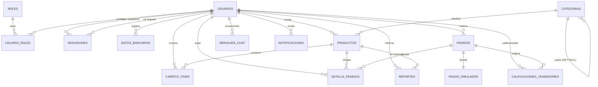

# Modelo de datos — CommerCity (BD compartida `commercity_v2`; el esquema local crea `commercity_dev`)

> Fuente: `schema_commercity.sql` (MySQL 8, InnoDB, `utf8mb4_unicode_ci`). Semilla: `seed_commercity.sql`.
> 16 tablas vigentes en 6 modulos + `schema_migrations` (ledger de migraciones). Notas de negocio verificadas contra el codigo (`utils/finanzas.js`, `utils/reembolsos.js`, controllers).
> Tablas en desuso RETIRADAS del esquema canonico el 2026-10-11 (siguen en la BD real, sin uso por el codigo): `etiquetas`, `producto_etiquetas`, `calificaciones_productos` (TASK-7.6/TASK-7.7).

## Diagrama entidad-relacion

## Modulo 1 — Usuarios y roles

### `roles`
| Columna | Tipo | Nulo | Clave / extra | Notas |
|---|---|---|---|---|
| id | INT AUTO_INCREMENT | no | PK | — |
| nombre | VARCHAR(50) UNIQUE | no | UNIQUE | `comprador` (default) \| `vendedor` \| `administrador` (seed) |
| descripcion | VARCHAR(255) | si | — | — |

### `usuarios`
| Columna | Tipo | Nulo | Clave / extra | Notas |
|---|---|---|---|---|
| id | INT AUTO_INCREMENT | no | PK | — |
| email | VARCHAR(150) UNIQUE | no | UNIQUE | Login; validado por Zod (`Login`) |
| password | VARCHAR(255) | no | — | Hash bcrypt (nunca plano) |
| nombre_completo | VARCHAR(100) | si | — | Unico campo editable por PATCH /me |
| foto_perfil | VARCHAR(255) | si | — | Ruta estatica |
| descripcion_personal | TEXT | si | — | Perfil publico |
| direccion_envio | TEXT | si | — | — |
| activo | TINYINT(1) DEFAULT 1 | no | — | 0 = baneado/desactivado; el auth es fail-closed |
| token_recuperacion | VARCHAR(100) | si | — | Flujo recover/reset (RF4) |
| token_recuperacion_expiracion | DATETIME | si | — | Expira a los 5 min; se guarda SHA-256 |
| created_at / updated_at | TIMESTAMP | no | — | updated_at ON UPDATE |

### `usuario_roles` (N:M usuarios <-> roles)
PK compuesta (usuario_id, rol_id); ambas FK con ON DELETE CASCADE.

### `seguidores`
PK (seguidor_id, seguido_id); ambas FK a usuarios con CASCADE; CHECK `seguidor_id <> seguido_id` (no seguirse a si mismo). `fecha_seguimiento` default now. Base de RF106/RF110.

## Modulo 2 — Finanzas

### `datos_bancarios`
| Columna | Tipo | Notas |
|---|---|---|
| id | INT AUTO_INCREMENT PK | — |
| usuario_id | INT UNIQUE, FK usuarios CASCADE | 1:1 por usuario |
| titular_nombre | VARCHAR(255) | Cifrado en reposo (`iv:tag:dato`); 255 cubre el ciphertext de un nombre largo (M-DB-1, mig 017). Zod `CuentaBancaria` valida el valor en claro |
| banco | VARCHAR(100) | Longitud de la BD real (M-DB-1, mig 017) |
| tipo_cuenta | VARCHAR(50) | `ahorros` \| `corriente` |
| numero_cuenta | VARCHAR(100) | Cifrado en reposo (RNF11); API enmascara lectura |
| es_commercity | TINYINT(1) DEFAULT 0 | 1 = cuenta de la plataforma (comision 10%) |
| updated_at | TIMESTAMP ON UPDATE | — |

## Modulo 3 — Catalogo

### `categorias`
id PK, nombre UNIQUE, descripcion NULL, categoria_padre_id FK autorreferencial ON DELETE SET NULL, activo default 1.

### ~~`etiquetas`~~ (RETIRADA del esquema 2026-10-11)
Tabla en desuso: el codigo no la consulta y el seed dejo de cargarla. Sigue en la BD real; su DROP es opcional y con aprobacion.

### `productos`
| Columna | Tipo | Notas |
|---|---|---|
| id | INT AUTO_INCREMENT PK | — |
| vendedor_id | INT, FK usuarios CASCADE | Dueño (ownership en controllers) |
| categoria_id | INT, FK categorias RESTRICT | No borra categoria con productos |
| nombre | VARCHAR(150) | Obligatorio |
| descripcion | TEXT | Obligatoria |
| imagen_url | VARCHAR(255) | Obligatoria (multipart `imagen`) |
| precio | DECIMAL(12,2) | **Ya incluye IVA 19% (RF48)**; > 0 |
| stock | INT DEFAULT 0 | Entero >= 0 |
| descuento_porcentaje | DECIMAL(5,2) DEFAULT 0 | 0-100 |
| estado | ENUM('Disponible','Agotado') GENERATED STORED | `IF(stock > 0, ...)` — lo calcula la BD |
| fecha_publicacion | DATETIME DEFAULT now | — |
| eliminado_por_admin | TINYINT(1) DEFAULT 0 | Suspension logica (bandeo admin) |

### ~~`producto_etiquetas` (N:M)~~ (RETIRADA del esquema 2026-10-11)
Tabla en desuso (misma decision que `etiquetas`).

## Modulo 4 — Compras y pagos

### `carrito_items`
id PK, comprador_id + producto_id (FK CASCADE), cantidad DEFAULT 1, UNIQUE (comprador_id, producto_id) para el upsert atomico, added_at, updated_at (limpieza RF109).

### `pedidos`
id PK, comprador_id FK RESTRICT (no borra usuario con pedidos), direccion_envio TEXT, total_neto DECIMAL(12,2), fecha_pedido. **Sin estado propio**: el estado vive por linea (RF119).

### `pagos_simulados` (pasarela simulada, 1:1 con pedido)
| Columna | Tipo | Notas |
|---|---|---|
| pedido_id | INT UNIQUE, FK pedidos CASCADE | 1:1 |
| metodo_pago | ENUM('tarjeta','transferencia','pse') | Zod `ConfirmarPago`; tarjeta exige Luhn (RF118) |
| referencia_pago | VARCHAR(100) UNIQUE | — |
| monto | DECIMAL(12,2) | Total cobrado **con IVA** |
| monto_reembolsado | DECIMAL(12,2) DEFAULT 0 | Acumula reembolsos por linea (RF135/RF35) |
| estado | ENUM('Aprobado','Rechazado','Pendiente','Reembolsado') DEFAULT 'Pendiente' | `Reembolsado` solo cuando reembolsado >= monto |

### `detalle_pedidos` (lineas)
pedido_id (CASCADE), producto_id (RESTRICT), vendedor_id (RESTRICT), cantidad, precio_unitario_historico, descuento_aplicado, subtotal (**sin IVA**), monto_vendedor + monto_comision (reparto **90/10 sobre el subtotal**, RF140; los calcula `calcularLinea`), estado_envio ENUM('Pendiente','En camino','Entregado','Cancelado') DEFAULT 'Pendiente', estado_pago_vendedor ENUM('Pendiente','Desembolsado'), fecha_desembolso NULL. Indice (vendedor_id, estado_envio) para el historial.

**Regla de dinero (RF48/RF121/RF140):** precio publicado con IVA incluido; subtotal = precio / 1.19; IVA = subtotal x 0.19 (desglose solo en pasarela); comision 90/10 sobre el subtotal.

## Modulo 5 — Reputacion

### `calificaciones_vendedores`
pedido_id (CASCADE) + vendedor_id, comprador_id (CASCADE), estrellas TINYINT CHECK 1-5, comentario TEXT NULL, fecha_calificacion. UNIQUE (pedido_id, vendedor_id): cada comprador califica una vez a cada vendedor del pedido (M-DB-5, mig 018). RF107.

### ~~`calificaciones_productos`~~ (RETIRADA del esquema 2026-10-11)
Tabla en desuso: el codigo solo califica vendedores; el seed dejo de cargarla.

## Modulo 6 — Comunicacion y moderacion

### `mensajes_chat`
emisor_id + receptor_id (FK CASCADE), mensaje TEXT, enviado_at, leido default 0. Indices por direccion (emisor,receptor) y (receptor,emisor) para conversaciones y no-leidos sargables (RF105). **Sin adjuntos** (sin columna archivo_url; el multipart se rechaza).

### `notificaciones`
usuario_id (CASCADE), tipo VARCHAR(50) (`compra`, `pedido enviado`, `en camino`, `entregado`, `devolucion`, `mensajes`, `reporte`; VARCHAR porque el ENUM truncaba), descripcion TEXT, estado VARCHAR(20) DEFAULT 'no leido' (sin acentos, como escribe el codigo), url_redireccion NULL, fecha_hora.

### `reportes`
informante_id NULL (FK usuarios **SET NULL**: el reporte sobrevive aunque se borre el informante), tipo_reporte ENUM('Producto','Usuario'), producto_id NULL / usuario_reportado_id NULL (FK **RESTRICT**: no se borra la entidad reportada mientras exista el reporte) con CHECK de exclusividad (uno y solo uno segun el tipo), motivo TEXT, evidencia_url NULL (multipart `evidencia`), estado_reporte ENUM('Pendiente','Resuelto') DEFAULT 'Pendiente', archivado default 0 (borrado logico), respuesta_admin NULL, respondido_at NULL, fecha_reporte. RF60-RF66. FKs ajustadas en TASK-7.7 (los reportes no se borran).

### `tokens_invalidados` (lista negra JWT, RF2)
token_hash CHAR(64) PK (SHA-256 del token revocado en logout), expira_en DATETIME (limpieza), creado_en. Indice en expira_en.
