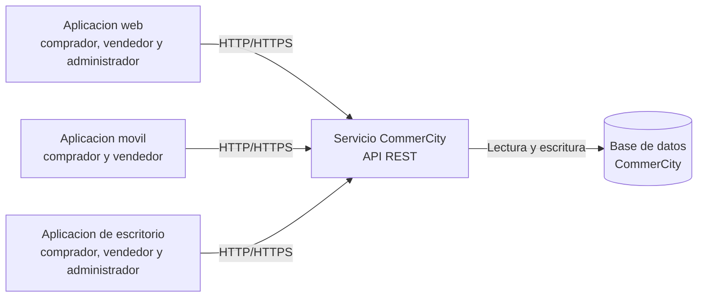
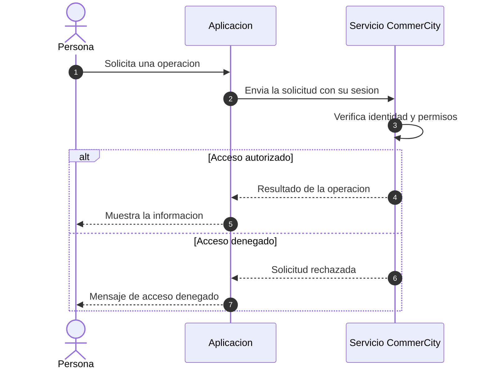
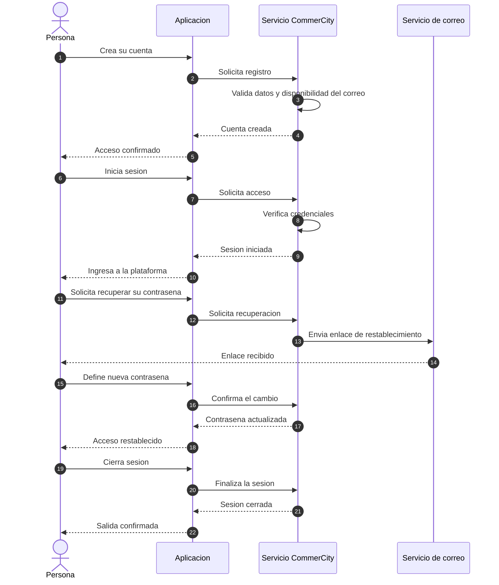
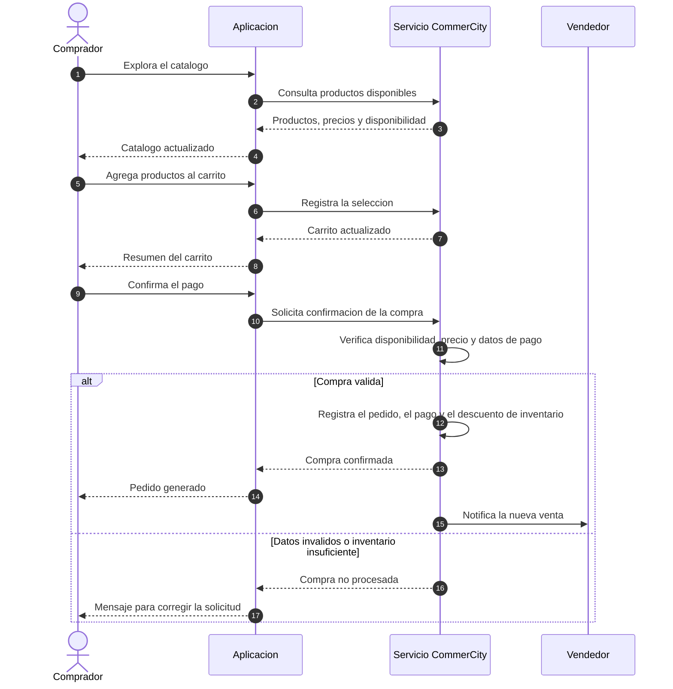
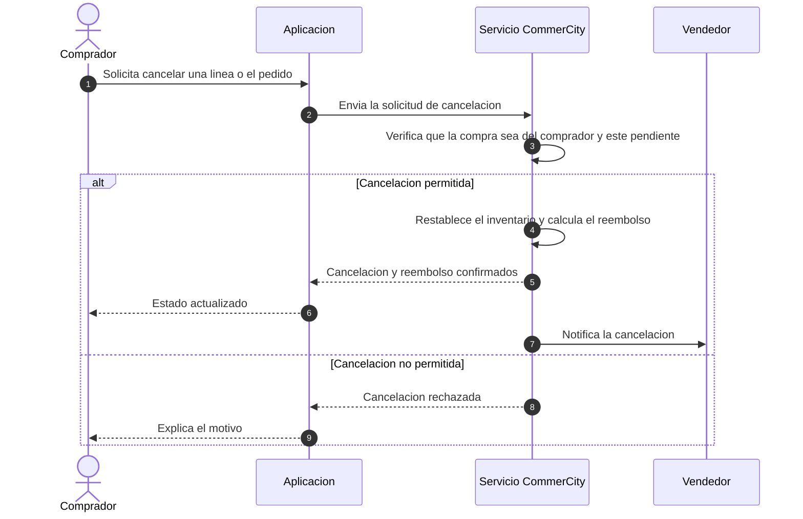
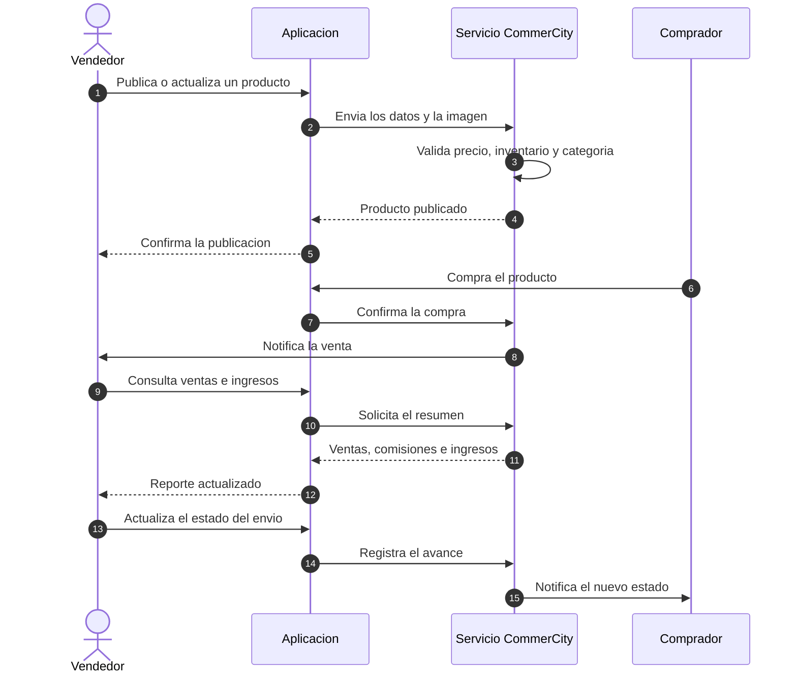
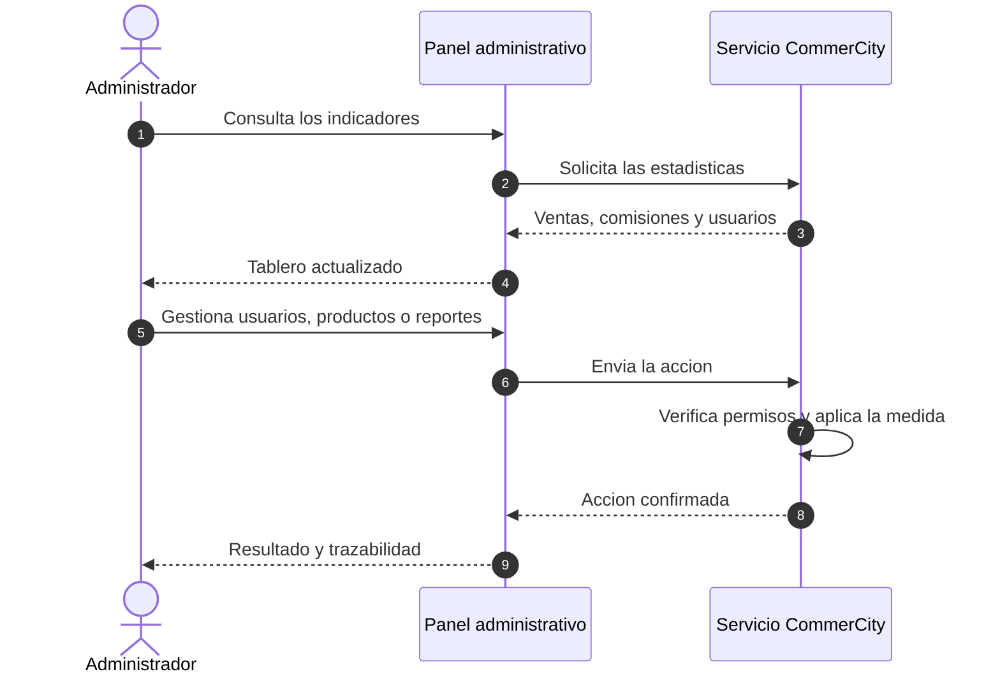
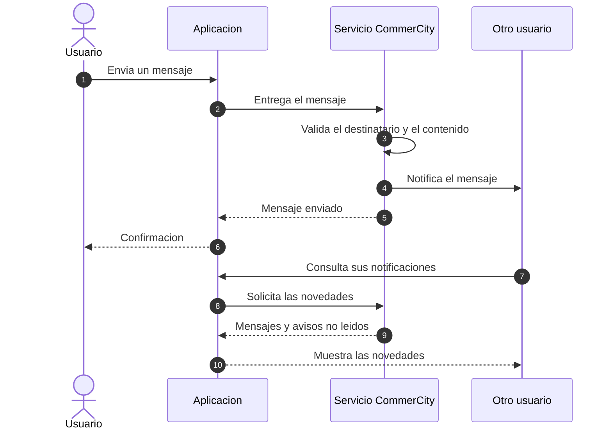

# Diagramas de negocio para la documentacion del 10 de noviembre

**Fecha:** 2026-10-31

**Alcance:** revision de los diagramas del `README.md` y de `docs/informes/FLUJO_UML_EJEMPLO_COMPRA.md` para la carpeta documental que se congela la semana del 10 de noviembre de 2026.

**Criterio del profesor:**

- Arquitectura: base de datos, API y front conectados por HTTP.
- Secuencia: flujo de negocio, sin middleware, sin endpoints y sin detalle de base de datos.

Este documento no modifica el README ni los diagramas existentes. Agrega la version de negocio que faltaba y deja por escrito que diagramas pueden usarse tal cual.

## 1. Clasificacion de los diagramas existentes

| # | Diagrama | Ubicacion | Clasificacion | Motivo |
|---|---|---|---|---|
| 1 | Arquitectura cliente-servidor | `README.md:28` | Sirve tal cual para la vision web | Muestra el front web, la API por HTTP y la base de datos. Para la vision de las tres apps usar la arquitectura de negocio de la seccion 2.1. |
| 2 | Multicanal: una sola API, tres clientes | `README.md:59` | Requiere version de negocio | Incluye puertos, `adb reverse`, pool de 10 conexiones y nombres de base de datos; el profesor pidio una arquitectura de negocio. |
| 3 | Ciclo de una peticion autenticada | `README.md:86` | Requiere version de negocio | Nombra middleware, rate limit, JWT, tablas y validacion Zod. No es un flujo de negocio. |
| 4 | Registro | `README.md:114` | Requiere version de negocio | Expone endpoint, bcrypt, JWT, tablas y transaccion. |
| 5 | Login | `README.md:138` | Requiere version de negocio | Expone endpoint, rate limit, JWT y consultas. |
| 6 | Recuperacion de contrasena | `README.md:162` | Requiere version de negocio | Expone endpoint, token, hash, tabla y proveedor de correo. |
| 7 | Logout y cierre de sesiones | `README.md:194` | Requiere version de negocio | Expone endpoint, middleware y tabla de tokens. |
| 8 | Catalogo y carrito | `README.md:211` | Requiere version de negocio | Expone endpoints, consultas y claves de base de datos. |
| 9 | Checkout ACID | `README.md:235` | Requiere version de negocio | Expone endpoints, transacciones, `FOR UPDATE` y tablas. |
| 10 | Estados de la linea | `README.md:272` | Sirve tal cual | Es un diagrama de estados de negocio, no una secuencia. La etiqueta del endpoint se puede leer como disparador de la transicion. |
| 11 | Estados del pago | `README.md:290` | Sirve tal cual | Es un diagrama de estados de negocio. La nota del ENUM es tecnica y no cambia la lectura. |
| 12 | Cancelacion y reembolso | `README.md:306` | Requiere version de negocio | Expone endpoints, transacciones, stock y tablas. |
| 13 | Vendedor | `README.md:340` | Requiere version de negocio | Expone endpoints, middlewares, SQL y almacenamiento de imagenes. |
| 14 | Administrador | `README.md:370` | Requiere version de negocio | Expone endpoints, RBAC y tablas. |
| 15 | Chat y notificaciones | `README.md:402` | Requiere version de negocio | Expone endpoints, limites, tablas y polling. |
| 16 | Migraciones y ledger | `README.md:439` | Requiere version de negocio | Es un proceso tecnico de despliegue. No se propone reemplazo; se excluye de la carpeta de negocio. |
| 17 | Consultas, transacciones y eventos | `README.md:470` | Requiere version de negocio | Es un diagrama tecnico de base de datos. No se propone reemplazo; se excluye de la carpeta de negocio. |
| 18 | Compra desde el carrito | `docs/informes/FLUJO_UML_EJEMPLO_COMPRA.md:13` | Requiere version de negocio | Expone endpoint, JWT, middleware, transacciones SQL, tablas y formulas. Usar la secuencia 2.4. |

## 2. Diagramas de negocio para la carpeta del 10-nov

Los siguientes diagramas reemplazan, a nivel de negocio, los diagramas tecnicos que no cumplen el criterio. No repiten endpoints, middleware ni nombres de tablas.

### 2.1 Arquitectura de negocio (web, movil y escritorio)

La API es la unica puerta de entrada a la base de datos. Las tres aplicaciones se comunican con ella por HTTP y no acceden directamente a los datos.

### 2.2 Operacion autenticada (RF1, RF2, RNF1)

### 2.3 Registro y acceso (RF1-RF13)

### 2.4 Compra (RF81-RF94, RF111-RF121, RF134-RF140)

El comprador ve el subtotal, el IVA del 19 % y el total. La comision se reparte 90 % para el vendedor y 10 % para CommerCity sobre el subtotal sin IVA.

### 2.5 Cancelacion y reembolso (RF35, RF135)

El reembolso es proporcional al importe de la linea cancelada y se acumula hasta cubrir el pago completo. Una linea ya entregada no se cancela por esta via.

### 2.6 Vendedor (RF44-RF49, RF122-RF139)

El vendedor recibe el 90 % del subtotal sin IVA. La cuenta bancaria se registra cifrada y se muestra enmascarada.

### 2.7 Administrador (RF55-RF80)

El administrador no puede quitarse a si mismo el rol. Las acciones de moderacion quedan registradas para trazabilidad.

### 2.8 Chat y notificaciones (RF99-RF110)

El chat es solo de texto y no admite adjuntos. Las notificaciones avisan de mensajes, compras, cancelaciones y cambios de estado.

## 3. Mapa de reemplazo para la carpeta del 10-nov

| Diagrama existente | Que usar en la carpeta del 10-nov |
|---|---|
| `README.md:28` Arquitectura cliente-servidor | Se puede usar para la vision web; la vision completa esta en 2.1. |
| `README.md:59` Multicanal | 2.1 Arquitectura de negocio. |
| `README.md:86` Ciclo de una peticion autenticada | 2.2 Operacion autenticada. |
| `README.md:114` Registro | 2.3 Registro y acceso. |
| `README.md:138` Login | 2.3 Registro y acceso. |
| `README.md:162` Recuperacion | 2.3 Registro y acceso. |
| `README.md:194` Logout | 2.3 Registro y acceso. |
| `README.md:211` Catalogo y carrito | 2.4 Compra. |
| `README.md:235` Checkout | 2.4 Compra. |
| `README.md:272` Estados de la linea | Se puede usar tal cual como apoyo. |
| `README.md:290` Estados del pago | Se puede usar tal cual como apoyo. |
| `README.md:306` Cancelacion y reembolso | 2.5 Cancelacion y reembolso. |
| `README.md:340` Vendedor | 2.6 Vendedor. |
| `README.md:370` Administrador | 2.7 Administrador. |
| `README.md:402` Chat y notificaciones | 2.8 Chat y notificaciones. |
| `README.md:439` Migraciones | No va en la carpeta de negocio; queda como anexo tecnico. |
| `README.md:470` Consultas y transacciones | No va en la carpeta de negocio; queda como anexo tecnico. |
| `docs/informes/FLUJO_UML_EJEMPLO_COMPRA.md` | 2.4 Compra. |

## 4. Recomendacion de armado

1. Abrir la carpeta con la arquitectura 2.1.
2. Incluir las secuencias 2.2 a 2.8 en el orden en que ocurre el negocio: acceso, compra, postventa, vendedor, administracion e interaccion social.
3. Agregar los dos diagramas de estados del README como apoyo, no como reemplazo de las secuencias. Si se exige cero detalle tecnico, dejarlos en el anexo y usar solo las secuencias 2.2 a 2.8.
4. Dejar las migraciones y el detalle de consultas como anexo tecnico fuera de la carpeta de negocio.
5. No incluir `FLUJO_UML_EJEMPLO_COMPRA.md` en su version actual: contiene endpoint, JWT, middleware, SQL y tablas. La version de negocio es 2.4.
