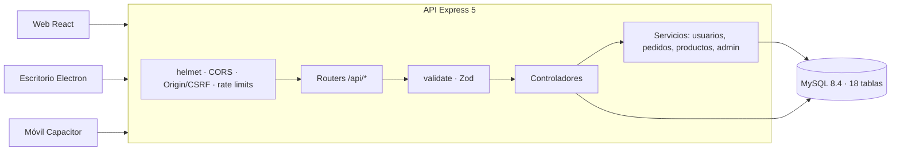

# Reauditoría backend y API — CommerCity (PREVIEW 1.5.9)

- **Fecha:** 2026-11-13
- **Rama auditada:** `PREVIEW` @ `8439525` (versión 1.5.9)
- **Alcance:** backend Express 5 + MySQL 8.4, API REST (76 operaciones), contrato OpenAPI, seguridad, datos, pruebas, CI y Docker.
- **Entorno de la corrida:** Windows 11, Node 24.22.1 (el CI usa Node 22), Vitest 4.1.11, dependencias según `backend/package-lock.json`.
- **Cambios de código:** una línea en `backend/scripts/verificar-entorno.mjs` (corrección de H1). Este documento registra la auditoría y esa corrección.

---

## 1. Resumen ejecutivo

**Veredicto:** el backend está bien diseñado en seguridad y contratos. La auditoría encontró un fallo que dejaba la suite en rojo (un archivo de pruebas no cargaba). Se corrigió con una línea y hoy la suite queda en verde.

| Indicador | Resultado verificado hoy |
|---|---|
| Archivos de prueba | 46 de 46 ejecutan (antes de corregir H1 eran 45 de 46) |
| Casos de prueba | 670 pasan (antes de corregir H1 eran 655; los 15 de `verificar-entorno.test.js` vuelven a cargar) |
| Cobertura | Líneas 97.17 % · Sentencias 96.36 % · Ramas 90.45 % · Funciones 99.33 % (cumple los umbrales 97 / 96 / 90 / 99) |
| Vulnerabilidades en dependencias de producción | 0 (`npm audit --omit=dev`) |
| Vulnerabilidades en dependencias de desarrollo | 6 (5 moderadas, 1 alta), reportadas por `npm ci` |
| Versión | 1.5.9 sincronizada (`tools/verificar-version.mjs`: OK) |
| Hallazgos | 1 media (corregida), 6 bajos y 2 informativos (sección 7) |

Los 670 casos que declara el CHANGELOG 1.5.9 son correctos y hoy pasan todos tras corregir H1. **Solo se corrigió H1; los demás hallazgos siguen abiertos.**

---

## 2. Arquitectura



**Capas:** `routes/` → `schemas/` (Zod, vía `validate()`) → `controllers/` → `services/` (4 dominios) → pool `mysql2`.

**Stack:** Node 22 (CI), Express 5.2, mysql2 3.24, Zod 4.6.7, jsonwebtoken 9, bcrypt 6, helmet 8, express-rate-limit 8, multer 2.5.0, Resend 6 (correo), Vitest 4.1.11.

---

## 3. API REST

Inventario verificado contra `docs/api/openapi.json` (OpenAPI 3.1.0, versión 1.5.9): **64 rutas, 76 operaciones, 43 esquemas**.

| Módulo | Ruta base | Operaciones | Acceso |
|---|---|---:|---|
| Base | `/health` | 1 | Público (comprueba la BD) |
| Usuarios | `/api/usuarios` | 14 | Público (registro, login, recuperación, perfil público) y Bearer |
| Productos | `/api` | 10 | Catálogo público; escritura solo `vendedor` |
| Pedidos | `/api/pedidos` | 3 | Bearer (checkout, cambio de estado) |
| Carrito | `/api/carrito` | 4 | Bearer |
| Historial | `/api/historial` | 2 | Bearer |
| Tienda | `/api/tienda` | 8 | Solo `vendedor` |
| Admin | `/api/admin` | 16 | Solo `administrador` (bloque `router.use`) |
| Reportes | `/api/reportes` | 1 | Bearer |
| Calificaciones | `/api/calificaciones` | 2 | Lectura pública; escritura Bearer |
| Chat | `/api/chat` | 4 | Bearer |
| Notificaciones | `/api/notificaciones` | 6 | Bearer |
| Seguidores | `/api/seguidores` | 5 | Bearer (contadores públicos) |
| **Total** | | **76** | |

**Formato de respuesta uniforme:**
- Éxito: `{ success: true, message?, data? }`.
- Error: `{ success: false, error: { code, message, details? } }`.
- Códigos usados: 400 (validación, con detalle por campo), 401 (credenciales o token, respuesta uniforme), 403 (rol o propiedad), 404, 409 (conflicto de negocio), 413 (archivo grande), 429 (límite), 503 (pool de BD saturado).

---

## 4. Seguridad (controles verificados en el código)

| Control | Implementación | Dónde |
|---|---|---|
| Autenticación | JWT HS256 con emisor, audiencia y expiración (24 h por defecto) y `jti` único | `utils/config.js`, `services/usuarios.service.js` |
| Revocación | Lista negra `tokens_invalidados` (logout) y `token_version` (reset, baneo, cierre de todas las sesiones) | `middleware/auth.middleware.js` |
| Cuenta desactivada | Se valida en cada petición autenticada con una sola consulta (activo, revocación, versión y roles) | `middleware/auth.middleware.js` |
| Autorización | `requireRoles` por ruta; `/api/admin` protegido en bloque | `middleware/role.middleware.js`, `routes/admin.routes.js` |
| Propiedad de recursos | El `WHERE` incluye al dueño: `usuario_id`, `receptor_id`, `comprador_id`, `vendedor_id` | controladores y servicios |
| Precios | El checkout recalcula precios y descuentos desde la BD; el cliente no los envía | `services/pedidos.service.js` |
| Contraseñas | bcrypt (10 rondas); mínimo 8, con letra y número, máximo 72 bytes; step-up con contraseña en operaciones sensibles | `schemas/auth.schemas.js` |
| Anti-enumeración | Registro responde igual exista o no el correo; login y recuperación con respuestas uniformes | `services/usuarios.service.js` |
| Fuerza bruta | Login: 10/min por IP y 5 intentos/15 min por cuenta; registro 5/h; reset 10/15 min; step-up 5 fallos/15 min por usuario | `app.js`, `middleware/rate-limit.middleware.js` |
| Cuotas generales | Lectura 1000 / 15 min; escritura 200 / 15 min por IP | `app.js` |
| CORS | Lista cerrada (`FRONTEND_URL`, `CORS_ALLOWLIST`); sin comodín `*` | `app.js` |
| CSRF | Con cookie de sesión se valida Origin/Referer en POST, PUT, PATCH y DELETE | `middleware/origin.middleware.js` |
| Cabeceras y cuerpo | helmet; `x-powered-by` desactivado; JSON limitado a 100 kb | `app.js` |
| Validación | Zod en la entrada (`validate`); esquemas de auth con `.strict()` | `middleware/validate.middleware.js` |
| Errores | Sin stack traces hacia el cliente; respuesta genérica | `middleware/error.middleware.js` |
| Datos bancarios | AES-256-GCM, clave derivada con HKDF y AAD por usuario; respuesta enmascarada | `utils/crypto.js`, `utils/cuentaBancaria.js` |
| Pagos | Simulados: el backend recibe solo los últimos 4 dígitos y la marca (M-28) | `services/pedidos.service.js` |
| Archivos | Validación por firma (magic bytes), máximo 5 MB, nombre aleatorio, evidencias privadas con JWT | `config/multer.js`, `app.js` |
| Auditoría | Tabla `auditoria_acciones` para bajas, cambios de rol, baneos, cambios bancarios y reportes | `utils/auditoria.js` |
| Configuración | El servidor no arranca sin `JWT_SECRET`; en producción exige `CRYPTO_SECRET_KEY` propia; `NODE_ENV` obligatorio | `utils/config.js`, `config/db.js` |
| Contenedor | Usuario `node` sin privilegios; healthcheck `/health` | `Dockerfile` |

---

## 5. Datos y transacciones

- **18 tablas** en `schema_commercity.sql`. **15 archivos de migración** (`000` y `008`–`021`), con control en `schema_migrations`.
- **Checkout (`confirmarPago`) en una sola transacción:** bloqueo `FOR UPDATE` del carrito y de los productos, validación de stock, creación de pedido y detalle, descuento de stock, registro del pago y vaciado del carrito. Si algo falla, `ROLLBACK`.
- **Stock nunca negativo:** `CHECK (stock >= 0)` (migración 021).
- **Montos:** IVA del 19 % calculado en vuelo (no se guarda). Reparto 90 % vendedor / 10 % comisión, con `monto_comision = subtotal − monto_vendedor`, de modo que ambos montos siempre suman el subtotal (1.5.8).
- **SQL dinámico:** en la revisión por búsqueda, las condiciones se construyen con marcadores `?`; no se encontró concatenación directa de valores del usuario. La revisión línea por línea queda pendiente (sección 8).

---

## 6. Pruebas, cobertura y controles

| Comando o control | Resultado |
|---|---|
| `npm ci` (backend, lockfile) | Correcto. Avisa que el script de instalación de `bcrypt` no está aprobado y reporta 6 vulnerabilidades en dependencias de desarrollo |
| `npm run test:coverage` (antes de corregir H1) | **Falla**: 45 archivos y 655 casos pasan; `verificar-entorno.test.js` no carga |
| `npm run test:coverage` (después de corregir H1) | Pasa: 46 de 46 archivos y 670 de 670 casos. Líneas 97.17 %, sentencias 96.36 %, ramas 90.45 %, funciones 99.33 % |
| `npm audit --omit=dev` | 0 vulnerabilidades |
| `tools/verificar-version.mjs` | OK (1.5.9 sincronizada) |
| `tools/ramas-estado.mjs --check` | Falla en este equipo: hay ramas de remotos adicionales sin integrar. En el CI solo existe `origin`, así que no se reproduce allí |
| Pruebas de integración con MySQL | No ejecutadas: requieren `TEST_DB_*` apuntando a una base desechable |

---

## 7. Hallazgos

| ID | Severidad | Hallazgo | Evidencia | Recomendación |
|---|---|---|---|---|
| **H1** | **Media (corregida)** | La suite `verificar-entorno.test.js` no carga. El script `backend/scripts/verificar-entorno.mjs` empieza con un shebang (`#!/usr/bin/env node`) y Vitest falla al importarlo (`SyntaxError: Invalid or unexpected token`). `node --check` sí lo acepta. Por eso el comando de cobertura termina con código 1. | Reproducido dos veces | **Corregido:** se quitó la línea `#!` (el script se ejecuta con `node` desde `npm run env:check`). Resultado: 46/46 archivos y 670/670 casos. |
| H2 | Baja (riesgo teórico) | En `confirmarPago`, la notificación se inserta dentro de la transacción con un `try/catch` vacío. Si ese INSERT provoca un deadlock, MySQL revierte toda la transacción, pero el código sigue, hace `COMMIT` sin efecto y responde éxito con un `pedido_id` que no quedó guardado. | Lectura del código; no reproducido | Mover la notificación después del `commit`, o aislarla con `SAVEPOINT`. Añadir una prueba de integración. |
| H3 | Baja | En `server.js`, el manejador de `unhandledRejection` cierra el proceso con código 0 aunque es un error. | `cerrar("unhandledRejection")` sin código | Pasar código `1`, igual que `uncaughtException`. |
| H4 | Baja | Los límites de uso (rate limit y cupo de subidas por usuario) viven en memoria del proceso. Con varias instancias, cada una cuenta por separado. | Almacén por defecto de `express-rate-limit`; `config/multer.js` lo documenta | Si se escala a más de una instancia, usar un almacén compartido (p. ej. Redis). |
| H5 | Baja | El inventario `docs/api/inventario-endpoints.md` marca ❌ en rutas que ya validan con Zod (p. ej. `GET /api/productos`). `openapi.json` sí refleja el estado real. | Comparación con `routes/productos.routes.js` | Actualizar la columna "Estado Zod" o generarla desde el registro. |
| H6 | Baja | Notificaciones valida el `:id` a mano en el controlador, mientras el resto de rutas usa `validate(..., "params")`. | `controllers/notificaciones.controllers.js` | Migrar a un esquema Zod para mantener la consistencia. |
| H7 | Baja (deuda técnica) | La capa de servicios cubre 4 de 12 módulos de rutas. `tienda.controllers.js` (28 KB), calificaciones, carrito, chat, historial, notificaciones, reportes y seguidores mantienen el SQL en el controlador. | Inventario de `routes/` y `services/` | Extraer servicios por dominio, como ya se hizo con usuarios, pedidos, productos y admin. |
| I1 | Informativa | El pago es simulado (`pagos_simulados`, siempre "Aprobado"). | `services/pedidos.service.js` | Presentarlo como simulación. |
| I2 | Informativa | JWT de 24 h sin refresh token. El `docker-compose.yml` de desarrollo usa el usuario root de MySQL y publica el puerto 3306. | `utils/config.js`, `docker-compose.yml` | Aceptable para desarrollo; no usar esa configuración en producción. |

---

## 8. Lo que no se verificó

- Pruebas de integración con MySQL real (no hay `TEST_DB_*` en este equipo).
- Ejecución del CI en GitHub Actions (no es accesible desde esta sesión; no se confirmó el resultado real del job `Backend`).
- Revisión línea por línea de las consultas dinámicas de `admin.service.js` y `productos.service.js`.
- Pruebas de carga: ver `docs/informes/INFORME_RENDIMIENTO_*` (2026-11-06). No se repitieron.
- Frontend y apps de escritorio y móvil (fuera del alcance de este informe).

---

## 9. Próximos pasos recomendados

1. **H1:** corregido. Confirmados 46/46 archivos y 670 casos en verde.
2. **H3 y H2:** escribir primero una prueba que falle, luego corregir.
3. **H5 y H6:** consistencia de documentación y validación.
4. **H7:** extraer servicios por etapas, separado de las correcciones de seguridad.

---

## 10. Cómo reproducir

```bash
cd backend
npm ci
npm run test:coverage
npm audit --omit=dev
```

```bash
node tools/verificar-version.mjs
```
